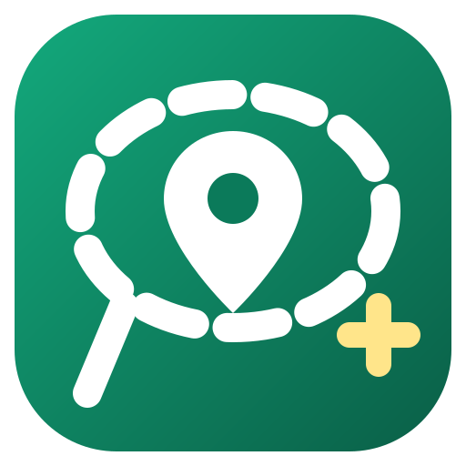

<p align="center"></p>

# Maps Plus — for Google Maps

An open-source Chrome extension that adds power-user features to Google Maps on the web. Each feature can be switched on or off in the options page.

> Maps Plus is an independent project. It is **not made by, affiliated with, or endorsed by Google**. It relies on undocumented parts of Google Maps that can change or break at any time, and your use of Google Maps remains subject to [Google's Terms of Service](https://policies.google.com/terms) and the [Google Maps Terms](https://maps.google.com/help/terms_maps/).

**Found a bug or have an idea? [Open an issue](https://github.com/domdino/maps-plus/issues).**

## Features

### Pano Date Resolver

Street View only tells you the month a photo was taken. Maps Plus adds a **Resolve date** button next to the "Image capture" label that finds the capture time to within about 2 seconds.

- Shows the time in your time zone. The tooltip shows UTC, the ±2 s accuracy, and the local time where the photo was taken (looked up offline; no time-zone API is called).
- Click the result to copy it.
- Takes about 22 quick requests, rate-limited and cached.
- Works best on the most recent imagery at a location. User-uploaded photospheres aren't supported.

Technique by **emily ([itisem](https://github.com/itisem))**: see [pano-date.emily.bz](https://pano-date.emily.bz) and [itisem/pano-date-resolver](https://github.com/itisem/pano-date-resolver). That repository has no license, so Maps Plus reimplements the idea from scratch rather than copying its code. All credit for the idea is theirs.

### Saved Places Lasso

A new map control (above the zoom buttons) lets you **drag a circle**, or hold **Shift** and draw a **freehand lasso**, around an area. A panel then lists every one of your saved places inside it (Starred, Want to go, Favourites, your own lists) with name, address, category, list, your note, and a photo where one is available.

- Sort by distance, name, or list. Filter by list. Remove rows you don't want.
- Export to **CSV** (opens cleanly in Excel and Numbers), **GeoJSON**, **KML** (Google Earth and My Maps), or a self-contained, print-ready **HTML report** with photos embedded. Use your browser's Print → Save as PDF to get a PDF.
- Esc cancels a selection. It needs a flat, untilted map. 3D, Globe, and Street View are refused rather than guessed at.

**Where the saved places come from:** Maps Plus reads the lists Google Maps has already loaded in your tab. Open **Saved** in the Maps sidebar and click into each list you want to use. Maps Plus picks those places up and remembers them locally. You can also import **Google Takeout** files (`Saved Places.json` and the per-list CSVs). Maps Plus never asks for your password and never makes signed-in requests.

**Photos and categories:** without any setup you get what Maps already loaded. For official photos, categories, and addresses, paste your own [Google Places API (New)](https://developers.google.com/maps/documentation/places/web-service/overview) key in the options page. That's the officially supported, ToS-friendly route. The key stays in your browser.

## Install

Until it's on the Chrome Web Store, build it yourself:

```bash
git clone https://github.com/domdino/maps-plus.git
cd maps-plus
npm install
npm run build
```

Then go to `chrome://extensions`, turn on **Developer mode**, click **Load unpacked**, and pick `.output/chrome-mv3`.

## Privacy

Maps Plus **does not collect or transmit any user data**. There are no analytics, no telemetry, and no servers of ours. Settings and the saved places it learns about stay in `chrome.storage.local` in your browser. It only contacts Google, and only when you click something. Full details are in [PRIVACY.md](PRIVACY.md).

### Permissions

| Permission                                        | Why                                                                                            |
| ------------------------------------------------- | ---------------------------------------------------------------------------------------------- |
| `storage`                                         | Your settings, the saved places Maps Plus has picked up, and a 30-day lookup cache             |
| `https://maps.googleapis.com/*`                   | The Street View metadata service used by **Resolve date**                                      |
| `https://places.googleapis.com/*`                 | Only used if you paste your own Places API key                                                 |
| `https://*.googleusercontent.com/*`               | Downloading place photos into an **HTML report** when you export one                           |
| Content scripts on `https://www.google.com/maps*` | Adding the buttons and panels, and reading saved-list data Maps has already loaded in that tab |

No `tabs`, `cookies`, `webRequest`, `scripting`, `downloads`, or `<all_urls>`. Exports are saved with a normal download link.

## Status and known limits

- **Verified on live Maps (2026-11-13, en-US):** the date resolver end to end (a Times Square pano resolved to 2024-08-22 15:26:13 UTC in 22 requests); the lasso projection at zoom 16 (selection rings land on the right landmarks); control placement; exports.
- **Not yet verified:** the layout of Maps' saved-list responses (`/maps/preview/entitylist/getlist`). That needs a signed-in session to check. The parser is deliberately structural, so it doesn't depend on exact positions, and [data-source.ts](src/features/saved-lasso/data-source.ts) documents what to check. **If your lists aren't picked up, please open an issue.** Takeout import works either way.
- The "Image capture" label is matched by its English text. In other languages the button floats in the bottom-left corner instead.
- Google's keyless Street View thumbnail endpoints now require a signed-in session, so without an API key, places with no photo show a placeholder.

## Development

```bash
npm install
npm run dev          # Chrome with the extension loaded and hot reload
npm run build        # production build -> .output/chrome-mv3
npm run zip          # packaged zip for the Chrome Web Store
npm run test         # unit tests (Vitest)
npm run lint
npm run typecheck
```

These test against live Google services, so they're opt-in and never run in CI:

```bash
LIVE=1 npx vitest run tests/live   # the date resolver against the real RPC (~22 requests)
npm run build && npm run e2e       # Playwright: loads the extension into Chromium on live Maps
```

Architecture and contributor rules are in [CLAUDE.md](CLAUDE.md). In short, each feature is an independent module in `src/features/`. Every Google Maps DOM selector lives in `src/shared/maps-dom.ts`. Only the background worker makes network requests, through one rate limiter.

## License

[MIT](LICENSE). The date-resolving technique is credited to emily / itisem (see above).
